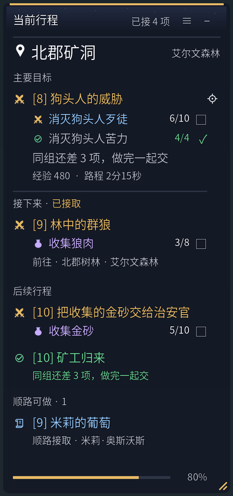
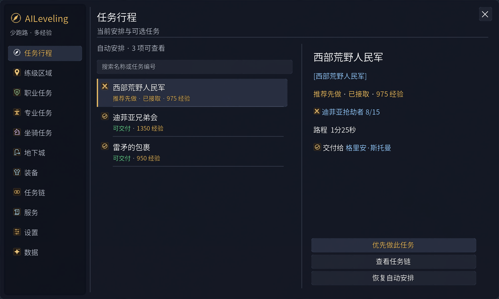

<h1 align="center">AILeveling</h1>

<p align="center"><b>少跑路，多经验。</b><br>为 World of Warcraft: Forever 动态安排接任务、做目标与集中交付。</p>

<p align="center">
  <a href="https://github.com/haphap/AiLeveling/releases"><b>下载安装包</b></a> ·
  <a href="#快速开始">快速开始</a> ·
  <a href="#功能">功能</a> ·
  <a href="https://github.com/haphap/AiLeveling/issues">反馈问题</a>
</p>

从你当前的位置和任务进度出发，AILeveling 会考虑已接任务、可接任务与前置关系，把附近目标一起安排，并告诉你下一步去哪里、找谁、做什么。接取、完成和交付后，行程随游戏进度更新。

## 界面一览

<table>
  <tr>
    <td width="35%" valign="top" align="center">
      <a href="https://github.com/haphap/AiLeveling/blob/main/docs/images/tracker.png"></a>
      <br><b>边走边做。</b><br>目标数量、下一步与顺路机会集中显示。
    </td>
    <td width="65%" valign="top" align="center">
      <a href="https://github.com/haphap/AiLeveling/blob/main/docs/images/plan.png"></a>
      <br><b>看清整趟安排。</b><br>浏览任务、职业、专业、坐骑和地下城，点击查看详情。
    </td>
  </tr>
</table>

图片由插件实际 UI 代码渲染，使用示例数据；任务组合与进度用于展示布局。

## 快速开始

适用于 **WoW: Forever**，目标接口 `16001`、客户端构建 `1.60.1.70862`。

1. 安装以下两个依赖，并在游戏插件列表中启用：

   | 依赖 | 版本要求 |
   | --- | --- |
   | [QuestieDB](https://github.com/Questie/QuestieDB/releases/tag/v1.0.13) | v1.0.13 Forever；兼容 v1.0.12 或公开 Contract 4 的兼容发行版 |
   | [HereBeDragons](https://www.wowace.com/projects/herebedragons/files) | Forever 兼容包，包含 HBD 2.0 与 HBD-Pins 2.0 |

2. 从 [Releases](https://github.com/haphap/AiLeveling/releases) 下载附件 **`AiLeveling-*.zip`**。将其中的 `AiLeveling` 文件夹解压到：

   ```text
   World of Warcraft/_forever_/Interface/AddOns/AiLeveling/
   ```

   `AiLeveling.toc` 应直接位于这个文件夹中。GitHub 的 “Source code” 是源码归档，安装请使用上述 ZIP 附件。

3. 完全退出并重新启动游戏，启用 AILeveling。登录后查看小地图下方的任务列表；输入 **`/ail`** 打开主界面。

## 功能

- **动态任务行程。** 按当前位置、等级、任务进度与前置关系安排接取、目标和交付，比较整批经验与跑路距离。远处低收益任务降低优先级，也可自行暂缓或锁定任务。
- **一起做，一起交。** 合并附近与共同目标，同一 NPC 的任务尽量集中交付；完成后明确提示现在就近交，还是做完同组再交。主行程连续展示，沿途可接、可做的任务另列在“顺路可做”。
- **路过就提醒。** 附近有顺路目标时显示“顺便完成”、具体行动、剩余数量和距离，点击让箭头指路，右键忽略附近提示；同一目标再次忽略后，本次地图停留期间不再提示。
- **跨区导航。** 箭头和地图标记指向当前行动，列出步行、飞行、船只、地铁和炉石步骤。地面路程按直线距离与当前速度估算，交通结束后接续任务。
- **职业、技能与坐骑。** 达到条件后提醒职业任务、可学技能及坐骑任务，需要前置时先安排前置；可直接查看详情或前往本职业训练师。
- **装备提升。** 新获得的可用装备显示提升提示，点击换装或忽略。接任务时预告提升奖励，交任务时建议可选奖励；悬停物品链接查看对比。
- **副本任务准备。** 按等级和资格浏览地下城，列出关联任务、待接任务与前置，提供接取地点和跑路指引；从准备、入本到交付连续安排。
- **练级辅助。** 任务道具与目标按钮、背包整理、队伍进度、天赋方案、经验统计、稀有和危险提醒可按需使用。

## 常用操作

| 操作 | 作用 |
| --- | --- |
| `/ail` | 打开主界面与设置 |
| 左键任务 | 查看任务日志或待接任务详情 |
| 右键任务 | 优先做、暂缓、解除锁定 |
| 标题栏 ≡／右键标题栏 | 放大缩小字体、暂停、收起列表、恢复小地图对齐 |
| 拖动标题栏／右下角 | 移动面板／调整宽高 |
| `/ail pause`、`/ail resume` | 暂停引导／恢复自动安排 |
| 与 NPC 对话时按住 Shift | 临时手动接交和选择航线 |

任务状态使用图标与颜色区分：**蓝色待接、金色已接、绿色可交付**。目标数量实时更新，完成项保留勾选标记。

<details>
<summary>更多命令</summary>

| 命令 | 作用 |
| --- | --- |
| `/ail bags` | 背包整理与垃圾／保留标记 |
| `/ail party` | 队友进度与任务共享 |
| `/ail talents` | 保存、预览和载入天赋方案 |
| `/ail stats` | 经验效率与等级耗时统计 |
| `/ail history` | 已完成任务历史 |
| `/ail way 地图ID 横坐标 纵坐标` | 设置手动目的地，坐标范围 0—100 |
| `/ail status` | 查看版本和诊断信息 |

任务物品按钮可在“系统按键设置 → AILeveling”绑定快捷键。

</details>

## 更新与反馈

更新前退出游戏，备份原 `AiLeveling` 文件夹，再用新安装包替换。保留账号与角色的 `SavedVariables/AiLeveling.lua`（以及同名 `.lua.bak`），即可保留设置和任务选择；需要回退时恢复备份。

遇到任务安排、导航或显示问题，请在 [Issues](https://github.com/haphap/AiLeveling/issues) 提供任务名、所在区域、具体操作，以及 `/ail status` 的诊断信息。界面问题可附截图。每个 Release 都附有安装 ZIP 和 SHA256 校验文件。

## 致谢与许可

任务数据由 [QuestieDB](https://github.com/Questie/QuestieDB) 提供，坐标与地图标记使用 [HereBeDragons](https://www.wowace.com/projects/herebedragons)。界面与交互参考 [Polestar](https://github.com/fitzforge/polestar)、[LumensUI](https://www.curseforge.com/wow/addons/lumensui)、[RestedXP](https://github.com/RestedXP/RXPGuides) 和 [Lueur](https://www.curseforge.com/wow/addons/lueur)。

自有代码采用 [MIT](https://github.com/haphap/AiLeveling/blob/main/LICENSE)。Polestar 装备图标按 [GPL-3.0](https://github.com/haphap/AiLeveling/blob/main/docs/LICENSE.Polestar.txt) 分发；RestedXP 危险位置与急救参考数据按 [CC BY-NC-SA 4.0](https://github.com/haphap/AiLeveling/blob/main/docs/LICENSE.RestedXP.txt) 分发。游戏界面素材版权归 Blizzard Entertainment，来源与版本见 [来源记录](https://github.com/haphap/AiLeveling/blob/main/docs/SOURCES.json)。
