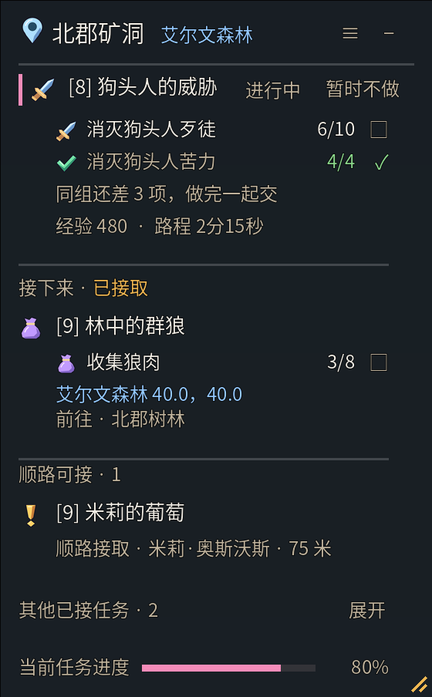

<h1 align="center">AILeveling</h1>

<p align="center"><b>少跑路，多经验。</b><br>为 World of Warcraft: Forever 动态安排接任务、做目标与集中交付。</p>

<p align="center">
  <a href="https://github.com/haphap/AiLeveling/releases"><b>下载安装包</b></a> ·
  <a href="#快速开始">快速开始</a> ·
  <a href="#功能">功能</a> ·
  <a href="https://github.com/haphap/AiLeveling/issues">反馈问题</a>
</p>

从你当前的位置和任务进度出发，AILeveling 会考虑已接任务、可接任务与前置关系，把附近目标一起安排，并告诉你下一步去哪里、找谁、做什么。打怪和拾取时，列表实时更新数量。同一区域内走动和停下会沿用当前行程。接取或交付任务、完成子目标、升级或换区时，插件会重新安排下一步。

## 界面一览

<table>
  <tr>
    <td width="35%" valign="top" align="center">
      <a href="https://github.com/haphap/AiLeveling/blob/main/docs/images/tracker.png"></a>
      <br><b>边走边做。</b><br>目标数量、下一步与顺路机会集中显示。
    </td>
    <td width="65%" valign="top" align="center">
      <a href="https://github.com/haphap/AiLeveling/blob/main/docs/images/plan.png"></a>
      <br><b>看清整趟安排。</b><br>浏览任务、职业、专业、坐骑和地下城。在地下城详情切换「装备掉落」，按首领查看装备和物品提示。
    </td>
  </tr>
</table>

[查看副本内七项任务的追踪预览](docs/images/dungeon-tracker.png)。以上图片由插件实际 UI 代码使用示例任务渲染。

## 快速开始

适用于 **WoW: Forever**，目标接口 `16001`、客户端构建 `1.60.1.70862`。

1. 安装以下两个依赖，并在游戏插件列表中启用：

   | 依赖 | 版本要求 |
   | --- | --- |
   | [QuestieDB](https://github.com/Questie/QuestieDB/releases/tag/v1.1.5) | 推荐 v1.1.5 Forever。v1.0.12 和 v1.0.13 缺少河林「陆行鸟之歌」等任务的位置数据，已有安装也请更新。 |
   | [HereBeDragons](https://www.wowace.com/projects/herebedragons/files) | Forever 兼容包，包含 HBD 2.0 与 HBD-Pins 2.0 |

2. 从 [Releases](https://github.com/haphap/AiLeveling/releases) 下载附件 **`AiLeveling-*.zip`**。将其中的 `AiLeveling` 文件夹解压到：

   ```text
   World of Warcraft/_forever_/Interface/AddOns/AiLeveling/
   ```

   `AiLeveling.toc` 应直接位于这个文件夹中。GitHub 的 “Source code” 是源码归档，安装请使用上述 ZIP 附件。

3. 完全退出并重新启动游戏，启用 AILeveling。登录后查看小地图下方的任务列表；输入 **`/ail`** 打开主界面。

## 功能

- **动态任务行程。** 按当前位置、等级、任务进度与前置关系安排接取、目标和交付，比较整批经验与跑路距离。自动跳过过级、往返远且收益低的任务，保留同路目标和有价值的后续；也可自行暂缓或锁定任务。
- **任务追踪。** 常规任务栏依次显示区域、目的地、当前动作和下一步。跨区行程默认展开，逐段列出步行、换乘与预计耗时。有本次练级记录时，底部显示每小时经验和预计升级时间。未完成数量显示为金色，可交付任务显示为绿色。副本内按当前追踪、进行中、可交付和待接取展示。DaylightUI 提供字体和控件。任务栏默认全透明，无外框和阴影。在「设置 → 界面显示」可单独调整任务栏、下一步与附近提示、详情窗口的背景透明度，默认依次为 100%、60%、10%。
- **Shortest Path Forever。** 启用后，AILeveling 把选定的野外任务地点或副本入口交给它规划交通，行程列表和中央导航显示它返回的步骤。进入副本后继续按房间和任务目标导航。玩家自己在 Shortest Path 中选定的目的地优先。未启用或路线不可用时使用内置导航。
- **按批次换区。** 先完成本区值得做的已接任务并集中交付，再前往下一站；行程明确列出要交的任务、下一站要接的任务，以及适合升级后回访的任务。
- **一起做，一起交。** 合并附近与共同目标，同一 NPC 的任务尽量集中交付；完成后明确提示现在就近交，还是做完同组再交。当前步骤和下一步连续展示，稍后才做的已接任务收在列表底部，点击「其他已接任务」可展开。附近可接任务与未开通飞行点列在主行程之后，点击即可导航；适合下一级做的本地任务可先接备用，并标明建议等级。
- **路过就提醒。** 附近有顺路目标时显示“顺便完成”、具体行动、剩余数量和距离，点击让箭头指路，右键忽略附近提示；同一目标再次忽略后，本次地图停留期间不再提示。
- **地图标记。** 大地图用角标显示行程顺序，职业色外环标出当前目的地。开启游戏的低等级任务追踪后，大地图和小地图用小灰色感叹号显示行程外的低等级可接任务。关闭后隐藏这些候选点，当前行程照常显示。同一接取点优先显示适级任务。绿色问号可立即交付，灰色问号是后续交付。同一地点的多项交付可悬停查看；游戏已画出对应问号时，行程序号仍显示在旁边。小地图显示附近能做的任务和当前目的地方向。左键点击已接任务的目标标记，可在大地图查看游戏自带的任务范围。
- **目标巡逻路线。** 点击已接任务打开详情，或点击地图上的任务目标，大地图会用金线标出目标的巡逻路线。河林的「通缉：幽魂之颚」显示沿河搜寻的参考线。
- **飞行地图。** 与飞行管理员交谈后，AILeveling 会为当前角色记住从本站可搭乘的航班。行程需要搭飞机时，航线图会在可搭乘的目的站上显示箭头和「下一步 · 站名」。启用自动乘坐时，先显示标记 1 秒再起飞。按住 Shift 打开航线图可手动选择。
- **跨区导航。** AILeveling 的导航界面显示当前步骤和下一步。途中提示在哪里搭车、坐船或转乘，抵达后指引接取、完成或交付任务。启用 WaypointUI 时由它显示方向和距离，步骤文字持续显示。副本内即使没有可用坐标，也能查看当前任务指引。
- **副本任务模式。** 进本后，小地图下原有的任务列表自动切换到当前副本。列表逐项显示进行中、未接取和可交付的任务，沿用原来的图标、目标计数和滚动方式。漏接的任务显示接取指引或前置，完成后提示在本内还是出本后交付。点击「副本任务」可打开详情。出本后原位恢复练级行程。
- **职业、技能与坐骑。** 在主窗口左侧切换“练级任务”和“职业任务”可查看各自的任务。点击“跟随这条职业任务线”后从前置推进到解锁，点击“恢复练级导航”返回自动安排。可学技能在任务列表提醒，坐骑解锁可在“坐骑任务”中查看。
- **装备提升。** 悬停背包装备时，物品提示底部列出各专精的单件属性分。可以比较换装时，还会显示相对已装备物品的变化，绿色为提升，红色为下降。等级不足的装备标出所需等级，旁边的已装备物品也显示属性分。戒指和饰品分别与已穿的两个栏位比较。任务列表内显示新装备和提升幅度，右键换装，点 × 可忽略。接任务时预告奖励，交任务时悬停物品可比较。自动模式按已应用天赋中投入最高的一系评分，覆盖九个职业的 28 个专精方向。野性德鲁伊选择坦克职责时按熊形态评分。天赋尚未分出主系时沿用职业基础评分。背包和任务奖励共用专精、等级和武器栏位权重。百分比表示换装的属性评分变化，命中与精准按等级点数计算。具体战斗的命中上限、技能循环和条件触发收益需结合目标判断。
- **副本任务准备。** 在推荐等级内优先提示正在推进任务线的副本，再看入口是否位于当前地图。条件相同时，先提示升一级就会超过推荐范围、且仍有本内任务可做的副本，再按本次可做副本任务的已知经验总和排序，经验相同优先路程较短的副本。本内可接的任务也计入，待解锁任务在前置完成后计入；部分奖励未知时，界面显示已知经验下限。未到推荐等级时提示可提前做的准备或本内交付。主任务列表显示建议和任务数，点击可查看待接任务与前置。选择后从准备、入本到交付连续指引。点击“返回正常练级”可随时结束副本安排，已接任务和进度保留。
- **练级辅助。** 任务道具与目标按钮、背包整理、队伍进度、天赋方案、经验统计、稀有和危险提醒可按需使用。

## 常用操作

| 操作 | 作用 |
| --- | --- |
| `/ail` | 打开主界面与设置 |
| 左键点任务名 | 已接任务打开游戏任务日志，未接任务打开插件详情。打开过接取对话后，可在详情里回看 NPC 原文和任务目标。首次到访前可复制该任务的 Wowhead 无限服链接 |
| 右键任务，选「导航到此任务」 | 指向接取地点。开启自动接取时，对话只接所选任务，随后继续原行程。物品起始任务显示使用入口 |
| 当前推荐旁点「暂时不做」 | 保留任务进度，继续推荐其他任务。角色下次升级时，这项任务会重新参与推荐 |
| 右键点任务，或在任务详情里点「忽略此任务」 | 此角色持续忽略该任务。想重新做时，在「任务行程」里选中标有「已忽略」的任务，点「恢复推荐」。暂缓的任务也可以提前恢复 |
| 标题栏 ≡／右键标题栏 | 放大缩小字体、暂停、收起列表、恢复小地图对齐 |
| 拖动标题栏／右下角 | 移动面板／调整宽高 |
| `/ail pause`、`/ail resume` | 暂停引导／恢复自动安排 |
| 与 NPC 对话时按住 Shift | 临时手动接交和选择航线 |

任务状态使用图标与颜色区分：**蓝色待接、金色已接、绿色可交付**。目标数量实时更新，完成项保留勾选标记。

<details>
<summary>更多命令</summary>

| 命令 | 作用 |
| --- | --- |
| `/ail bags` | 背包整理与垃圾／保留标记 |
| `/ail party` | 队友进度与任务共享 |
| `/ail talents` | 保存、预览和载入天赋方案 |
| `/ail stats` | 经验效率与等级耗时统计 |
| `/ail history` | 已完成任务历史 |
| `/ail way 地图ID 横坐标 纵坐标` | 设置手动目的地，坐标范围 0—100 |
| `/ail status` | 查看版本和诊断信息 |

当前步骤需要的物品显示在中央导航框底部，左键点击图标即可使用，悬停说明可查看完整需求。战斗外左键拖动导航框，或按住物品图标右键拖动，整框位置随配置保存。快捷键在“系统按键设置 → AILeveling”绑定。

中央导航下方按行列出当前任务 NPC 的头像和名字。点一行会选中附近对应的 NPC 并标记，友善目标用星星，可攻击目标用骷髅。超过四个目标可滚轮翻页，战斗外右键拖动头像行可移动整组导航。战斗中保留进入战斗时的目标列表，脱战后更新。行程里的准星和快捷键也可选中目标。接任务和做目标时，姓名板旁会显示对应图标。交任务时看 NPC 头顶的系统问号，也可以点击头像选中并标记交付人。已有的团队标记会保留。在团队中由团长或助理加标记。“设置 → 任务辅助”可控制头像列表及标记。

</details>

## 更新与反馈

更新前退出游戏，备份原 `AiLeveling` 文件夹，再用新安装包替换。保留账号与角色的 `SavedVariables/AiLeveling.lua`（以及同名 `.lua.bak`），即可保留设置和任务选择；需要回退时恢复备份。

遇到任务安排、导航或显示问题，请在 [Issues](https://github.com/haphap/AiLeveling/issues) 提供任务名、所在区域、具体操作，以及 `/ail status` 的诊断信息。界面问题可附截图。每个 Release 都附有安装 ZIP 和 SHA256 校验文件。

## 致谢与许可

任务接取、目标与交付使用无限版 [QuestieDB](https://github.com/Questie/QuestieDB)。任务奖励和飞行耗时采用无限版客户端与服务器记录。坐标与地图标记使用 [HereBeDragons](https://www.wowace.com/projects/herebedragons)。界面与交互参考 [Polestar](https://github.com/fitzforge/polestar)、[LumensUI](https://www.curseforge.com/wow/addons/lumensui)、[RestedXP](https://github.com/RestedXP/RXPGuides) 和 [Lueur](https://www.curseforge.com/wow/addons/lueur)。

自有代码采用 [MIT](https://github.com/haphap/AiLeveling/blob/main/LICENSE)。Polestar 装备图标按 [GPL-3.0](https://github.com/haphap/AiLeveling/blob/main/docs/LICENSE.Polestar.txt) 分发；RestedXP 危险位置与急救参考数据按 [CC BY-NC-SA 4.0](https://github.com/haphap/AiLeveling/blob/main/docs/LICENSE.RestedXP.txt) 分发。游戏界面素材版权归 Blizzard Entertainment，来源与版本见 [来源记录](https://github.com/haphap/AiLeveling/blob/main/docs/SOURCES.json)。
